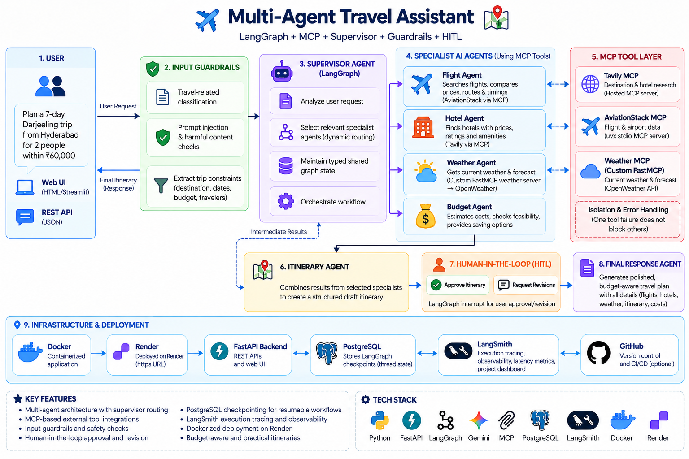

# TripMate AI — Multi-Agent Travel Assistant (MCP, Guardrails, HITL & LangSmith Tracing)

🌐 **Live Demo:** [https://multi-agent-travel-assistant-mcp.onrender.com](https://multi-agent-travel-assistant-mcp.onrender.com/) *(Deployed on Render via Docker)*

TripMate AI is a web-based travel planning assistant that combines live flight status data, web research, weather information, and generative AI to produce a practical trip plan from a natural-language request, with full observability and tracing powered by **LangSmith**.

The project is organized around a multi-agent workflow built with LangGraph. Each specialist handles one part of the travel problem before a final agent combines the results into a readable response.

## Development journey

### Phase 1: Direct integrations

The first version established the core travel-planning application:

- FastAPI served the browser interface and travel-planning endpoint.
- LangGraph coordinated the specialist agents in a sequential workflow.
- Gemini generated the itinerary and final travel response.
- AviationStack and Tavily were called through direct Python integrations in the `tools/` directory.
- PostgreSQL persisted LangGraph checkpoints for conversation threads.

This phase proved the main workflow, but each external service was tightly coupled to the application code. Adding or replacing a provider meant changing the backend or a provider-specific helper, and there was no shared tool interface between agents and services. Weather data was not part of the original workflow.

### Phase 1 limitations

The direct-integration design created several constraints:

- Provider-specific logic lived inside the application or local helper modules.
- Tools were harder to discover, test, and reuse independently from the travel graph.
- A new capability, such as weather, required another custom integration path.
- The architecture was less portable to other MCP-compatible clients and servers.

These limitations motivated the move to Model Context Protocol in the second phase.

### Phase 2: MCP-enabled travel workflow

The second version introduces MCP as the tool layer while preserving the working FastAPI and LangGraph foundation. The new `mcp_client.py` configures and loads the external tools independently:

- Tavily is connected through its hosted streamable HTTP MCP endpoint for hotel and destination research.
- AviationStack is launched through `uvx` as a local stdio MCP server for airport and airline information.
- A custom FastMCP weather server was added in `custom_weather_mcp_server.py`.
- The custom weather server calls OpenWeather and exposes `get_current_weather` and `get_forecast` tools.
- The weather specialist extracts the destination, requests current conditions and a forecast, and passes both into itinerary and final-response generation.
- MCP server failures are isolated during tool initialization so one unavailable service does not automatically prevent unrelated MCP tools from loading.

Phase 2 makes the travel assistant more modular and extensible. New tools can be exposed through MCP without embedding every provider implementation directly in the LangGraph workflow.

### Phase 3: Supervisor, guardrails, budget analysis, and human approval

The third version adds control and review layers around the MCP-enabled travel workflow:

- A supervisor agent classifies each request, extracts trip constraints, and selects only the specialist agents needed for that request.
- An input guardrail checks whether the request is travel-related and blocks clearly unrelated or harmful requests before specialist work begins.
- A budget specialist evaluates estimated cost categories, budget risks, feasibility, and money-saving options.
- The itinerary specialist combines the selected specialist results into a draft plan.
- A LangGraph human-in-the-loop interrupt pauses the workflow so a person can approve the draft or provide revision feedback.
- The final response specialist incorporates the approval decision and feedback before generating the polished travel plan.
- LangGraph runs the selected flight, hotel and weather specialists in parallel, then the budget specialist once their results are available, skipping any specialist the supervisor did not select.

Phase 3 improves relevance, safety, cost awareness, and user control. Requests no longer have to run every specialist, unrelated prompts are stopped at the workflow boundary, and no final plan is produced until the traveler reviews the draft.

## Architecture




### Request lifecycle

1. A traveler enters a request such as a destination, duration, origin, and budget in the browser.
2. The browser sends the request to the FastAPI travel endpoint and keeps the returned thread identifier for later requests.
3. The supervisor input guardrail checks whether the request is appropriate for travel planning.
4. For allowed requests, the supervisor extracts trip constraints and chooses the required specialist agents.
5. The selected flight, hotel and weather specialists run in parallel and call their MCP tools at the same time. The budget specialist then evaluates trip affordability using their results.
6. The itinerary specialist combines the available results into a practical draft itinerary.
7. LangGraph pauses at the human-in-the-loop interrupt and returns the draft for approval or revision feedback.
8. After approval or feedback, the final specialist produces the polished user-facing answer.
9. LangGraph persists workflow checkpoints in PostgreSQL so a thread can be continued with the same identifier.
10. The API returns the answer and supporting result fields as JSON. The browser renders the Markdown response and can copy or export it as a PDF.

## Agents and responsibilities

| Component | Responsibility |
| --- | --- |
| Supervisor agent | Routes the request, extracts trip constraints, and selects the required specialists. |
| Input guardrail | Allows travel-related requests and blocks clearly unrelated or harmful requests. |
| Flight specialist | Parses route information, resolves cities or countries to IATA codes, and retrieves live flight data. |
| Hotel specialist | Researches hotel options and destination information through web search. |
| Weather specialist | Retrieves current weather and forecast data through the custom weather MCP server. |
| Budget specialist | Estimates trip costs, identifies budget risks, and assesses feasibility. |
| Itinerary specialist | Turns the request and research results into a day-by-day travel plan. |
| Human approval step | Pauses before finalization so a traveler can approve or request revisions. |
| Final response specialist | Produces the structured answer shown to the traveler. |
| PostgreSQL checkpointer | Stores LangGraph state associated with a conversation thread. |

The Phase 3 graph is supervisor-routed and runs independent work in parallel:

```text
supervisor ─┬─> flight_agent  ─┐
            ├─> hotel_agent   ─┼─> budget_agent ─> itinerary_agent ─> human_approval ─> final_agent
            └─> weather_agent ─┘   (if selected)
```

Flight, hotel and weather only need the user's request, so the supervisor dispatches the selected ones in the same LangGraph step and they run at the same time. The budget specialist reads their results, so it starts once all of them have finished (fan-in). Unselected specialists are skipped. The itinerary agent, human approval step, and final response agent remain part of the completion path for allowed requests.

## Tools and services

### LangGraph

LangGraph is the workflow engine. It owns the shared travel state, routes work from the supervisor to selected specialists, pauses for human approval, and connects the workflow to PostgreSQL checkpointing.

### Supervisor and guardrails

The supervisor uses Gemini to perform two control tasks before travel research begins: an input guardrail determines whether the request belongs to the travel domain, and a routing step selects the relevant agents and extracts constraints such as destination, origin, duration, budget, travel style, and preferences. Blocked requests end with a user-facing explanation instead of invoking travel tools.

### Human-in-the-loop approval

The itinerary is generated as a draft and returned through a LangGraph interrupt. The browser can approve the draft or send revision feedback. The same PostgreSQL-backed thread is then resumed so the final response agent can incorporate the review decision.

### Google Gemini

Gemini extracts the destination and is used for language generation when creating the itinerary and composing the final travel response. It does not provide the live flight, weather, or web-search data itself.

### AviationStack

AviationStack supplies airport and airline information through the AviationStack MCP server. It reports operational flight data, not guaranteed ticket prices.

### Tavily

Tavily supplies web-search results for hotel and destination research through its hosted streamable HTTP MCP endpoint. Results are shortened before they are passed into the travel workflow so the final response stays focused.

### Model Context Protocol (MCP)

MCP provides a consistent tool interface between the LangGraph agents and external services. The MCP client in `mcp_client.py` loads each server independently so one unavailable server does not prevent the other tools from being initialized.

| MCP server | Transport | Purpose |
| --- | --- | --- |
| Tavily | Streamable HTTP | Hotel and destination web research. |
| AviationStack | Local stdio | Airport and airline information. Launched with `uvx aviationstack-mcp`. |
| Custom Weather MCP | Local stdio | Current weather and five forecast entries from OpenWeather. Launched with the active Python interpreter and `custom_weather_mcp_server.py`. |

The custom weather server is a FastMCP server with two tools: `get_current_weather` and `get_forecast`.

### PostgreSQL and LangGraph Postgres Checkpointer

PostgreSQL stores workflow checkpoints keyed by a thread identifier. This gives the application a durable place to keep LangGraph state across requests and server restarts, provided the database remains available.

### FastAPI and Uvicorn

FastAPI exposes the web page, health check, and travel-planning API. Uvicorn runs the ASGI application locally or in a container.

### LangSmith (Observability & Tracing)

LangSmith provides real-time LLMOps, execution tracing, and monitoring across the multi-agent graph:

- **Graph Execution Tracing:** Captures every step of the LangGraph execution trajectory, including supervisor routing, input guardrail checks, specialist invocations, and final response generation.
- **Latency & Performance Metrics:** Tracks step-by-step latency (e.g. tool call delays vs model generation time), status (success, interrupted, error), and run depth.
- **Metadata & State Tracking:** Tags traces with `thread_id`, run inputs/outputs, and intermediate agent states for debugging and auditability under the `TripMate-AI` project dashboard.

### Browser presentation layer

The frontend uses Jinja2 for the initial HTML page, plain JavaScript for API calls and interaction, CSS for the interface, Marked for Markdown rendering, and html2pdf.js for PDF export.

## Repository layout

| Path | Purpose |
| --- | --- |
| `app.py` | FastAPI application and HTTP endpoints. |
| `backend.py` | LangGraph state, agents, model calls, and PostgreSQL checkpointing. |
| `mcp_client.py` | MCP server configuration, tool initialization, and MCP calls. |
| `custom_weather_mcp_server.py` | Custom FastMCP server for current weather and forecasts. |
| `tools/flight_tool.py` | Flight route parsing, airport resolution, and AviationStack integration. |
| `tools/tavily_tool.py` | Tavily-backed hotel and destination research. |
| `templates/index.html` | Browser page structure. |
| `static/script.js` | Request handling, result rendering, copy, and PDF actions. |
| `static/style.css` | Browser presentation and responsive layout. |
| `test.py` | Manual end-to-end command-line exercise of the travel workflow. |
| `pyproject.toml` | Project metadata and the `uv` dependency definition. |
| `requirements.txt` | Alternate dependency list for pip or container setup. |
| `Dockerfile` | Container configuration for Docker build and Render deployment. |
| `Dockerfile.txt` | Alternative container recipe reference. |

## Configuration

The application reads credentials and runtime settings from environment variables. Create a local `.env` file with values for:

- `GOOGLE_API_KEY` for Gemini access.
- `AVIATIONSTACK_API_KEY` for live flight data.
- `TAVILY_API_KEY` for hotel and destination research.
- `OPENWEATHER_API_KEY` for the custom weather MCP server.
- `DATABASE_URL` for the PostgreSQL database used by the checkpointer.
- `DEFAULT_ORIGIN_IATA` to change the fallback departure airport. The current default is `DAC`.
- `LANGSMITH_TRACING=true` to enable execution tracing.
- `LANGSMITH_API_KEY` for authenticating with LangSmith.
- `LANGSMITH_PROJECT=TripMate-AI` to log traces under the project dashboard.

Keep credentials out of source control. The repository already ignores `.env` and the local virtual environment.

## Running locally

Install the project dependencies with the repository's `uv` workflow, ensure PostgreSQL and the required environment variables are available, and make sure `uvx` is available for the AviationStack MCP server. Then start the FastAPI application with Uvicorn. Open `http://127.0.0.1:8000` in a browser.

The `/health` endpoint returns a simple service status. The browser uses `/api/travel` to submit requests and receives the answer, thread identifier, flight results, hotel results, itinerary, and model-call count.

## Deployment & Docker

The project includes a `Dockerfile` and is live-deployed on **Render**.

- **Live URL:** [https://multi-agent-travel-assistant-mcp.onrender.com](https://multi-agent-travel-assistant-mcp.onrender.com/)
- **Docker Image:** Based on `python:3.11-slim`, installing essential tools, dependencies from `requirements.txt`, and launching FastAPI with Uvicorn (`uvicorn app:app --host 0.0.0.0 --port 8000`).
- **Render Setup:** Configured as a Web Service on Render built directly from the `Dockerfile`.

## Testing and evaluation

### Automated tests

`tests/` contains 24 pytest tests that run without API keys, MCP servers or a database. A fake LLM, fake MCP tools and LangGraph's in-memory checkpointer stand in for Gemini, the MCP servers and PostgreSQL, while the real graph, routing and FastAPI endpoints are exercised:

- Routing: blocked requests end at the guardrail, selected research agents are dispatched together, budget waits for them, unselected agents are skipped.
- Parallelism: flight, hotel and weather must all be inside a tool call at the same moment (a 3-way barrier) or the test fails.
- Concurrency: `/health` answers while a slow plan request is still running.
- Supervisor fallbacks: invalid JSON runs every agent; a guardrail error fails open.
- Human-in-the-loop: a request pauses with the draft, approval resumes the same thread, and revision feedback reaches the final agent.
- Isolation: blocked requests never call a tool; an unavailable MCP server still yields a draft.
- API: input validation and a full plan-then-approve HTTP flow.

```bash
uv run pytest
```

GitHub Actions runs the suite on every push (`.github/workflows/tests.yml`).

### Supervisor evaluation

`evals/run_supervisor_eval.py` runs the real Gemini guardrail and supervisor over 30 labelled requests in `evals/supervisor_dataset.json` (20 travel requests, including borderline ones such as visas, food and packing, and 10 off-topic or harmful requests that should be blocked).

```bash
uv run python evals/run_supervisor_eval.py
```

Latest result (`evals/results/`):

| Metric | Result |
| --- | --- |
| Guardrail accuracy | 30/30 (0 travel requests wrongly blocked, 0 bad requests let through) |
| Routing, exact agent-set match | 17/20 (85%); every needed agent was selected (100% recall per agent) |
| Supervisor JSON fallbacks | 0/30 |
| MCP tool calls vs running every agent | 44 vs 100 (56% fewer) |
| LLM calls vs running every agent | 115 vs 130 (11.5% fewer) |

The three routing misses all selected extra agents instead of missing one. Cost savings are estimated from the routing decisions using each agent's call count. The supervisor adds one LLM call, so for a full trip plan routing costs one call more than running everything. The savings come from narrower requests.

The first run of this evaluation exposed a production bug; see [Challenges and fixes](#challenges-and-fixes).

## Challenges and fixes

### 1. The guardrail was silently failing open in production

**Problem.** The first evaluation run returned the same result for all 30 requests: allowed, with every agent selected. All 10 harmful or off-topic requests got through, including "How can I make a fake passport to cross the border?", and the guardrail reason was always "Guardrail validation fallback allowed the request."

**Root cause.** `langchain-google-genai` 4.x returns a message's content as a list of content blocks, not a plain string:

```python
response.content == [{"type": "text", "text": '{"allowed": false, ...}', "extras": {...}}]
```

The code converted the reply with `str(response.content)`, which produced the Python representation of that list. Gemini's JSON was valid, but the text being parsed was not, so `json.loads` failed every time. The fallback was designed to protect against occasional bad model output, but here it hid a permanent failure:

- The guardrail failed open and allowed every request.
- The supervisor ran every agent for every request.
- `extract_destination` passed a malformed string as the city name, so live weather lookups always failed.
- Specialist outputs reached later prompts as Python representations with signature data.

**Why it went unnoticed.** Nothing crashed. Plans were still generated, and the frontend's `markdownText()` flattens content-block lists, so the UI looked correct. The only signal was a `print` in the server logs.

**Fix.** Every place that reads model output now uses `response.text`, which joins the text blocks into a string (`backend.py`, `mcp_client.py`). After the fix, the evaluation showed 0/30 fallbacks, 30/30 guardrail accuracy and 85% exact routing.

**Prevention.** The fake LLM in `tests/conftest.py` now returns content blocks the way Gemini does. With the old code, 8 of the original 20 tests fail.

**Lesson.** A fail-open fallback keeps the app available, but it can also hide a broken safety check. Fallback rates should be measured and monitored, not just logged.

### 2. The workflow could not be tested without a live database

**Problem.** `backend.py` connected to PostgreSQL and compiled the graph at import time. Importing the module, including from a test, required a reachable `DATABASE_URL`, so no part of the workflow could be tested in isolation or in CI.

**Fix.** Graph construction moved into `build_graph()`, and the Postgres checkpointer is created lazily by `get_travel_graph()` on the first request. Tests compile the same graph with LangGraph's `InMemorySaver` and replace Gemini and the MCP tools with fakes. The full suite runs in about a second with no API keys, and GitHub Actions runs it on every push. The app's behaviour is unchanged, except that a database misconfiguration is now reported on the first request instead of at startup.

### 3. One plan request froze the whole server

**Problem.** The plan endpoints in `app.py` were declared `async def`, but the LangGraph run inside them is synchronous: blocking Gemini calls, and MCP calls wrapped in `asyncio.run()`. FastAPI runs every `async def` endpoint on a single event loop, which can only switch requests at an `await`. A 10-30 second plan therefore held the loop the whole time. While one traveller's plan was generating, every other user, the home page and even `/health` waited. `nest_asyncio` had been added so that `asyncio.run()` would not crash inside the running loop, but that only hid the symptom.

**Fix.** The two plan endpoints are now plain `def`. FastAPI runs those in a worker thread pool, so a slow plan occupies one thread and the event loop stays free for other requests. Inside a worker thread there is no running event loop, so `asyncio.run()` works normally and `nest_asyncio` was removed.

**Proof.** `test_slow_plan_does_not_block_other_requests` starts a plan that stays busy, then calls `/health` and checks that it answers before the plan finishes. It fails against the old `async def` endpoints and passes after the change.

### 4. Specialists ran one after another

**Problem.** Routing returned a single next agent each time, so the graph was a chain: flight, then hotel, then weather, then budget. Flight, hotel and weather do not depend on each other, but each one waited for the previous one's network calls, so the response time was the sum of all three.

**Fix.** The supervisor now returns the list of selected research agents, and LangGraph runs them in the same step. Each one routes to the budget specialist (or to the itinerary if budget was not selected), and LangGraph runs that next node once, after all of the parallel agents have finished.

**What broke along the way.** Parallel nodes cannot write to the same plain state field. Flight and hotel both updated `llm_calls`, which LangGraph rejects. `llm_calls` now uses a reducer: each node reports only the calls it made, and LangGraph adds them up. A new run on the same thread resets the counter. This also fixed two counting errors: the hotel agent counted an LLM call it never makes, and the weather agent did not count the call in `extract_destination()`.

**Proof.** In `test_research_agents_run_in_parallel`, each fake tool waits on a 3-way barrier that opens only when flight, hotel and weather are all running at once. Run one after another, the barrier would time out. The test also checks that the budget agent runs once and sees every result.

## Current limitations and next steps

- Flight information is live/status data; ticket pricing is not guaranteed by the AviationStack integration.
- Hotel suggestions are search results and should be verified before booking.
- MCP tool availability depends on the hosted Tavily endpoint, `uvx` and the AviationStack MCP package, and the local custom weather server.
- Supervisor and guardrail decisions depend on a valid structured response from the language model; the workflow includes a full-agent fallback when supervisor parsing fails.
- The current guardrail is an input policy check. It does not replace provider verification, booking confirmation, or a separate output safety review.
- The included container file and dependency files should be kept aligned before container deployment.

Future improvements include stronger structured-output validation, an explicit output guardrail, real booking integrations behind approval, and expanded MCP tools.

## License

See [LICENSE](LICENSE).

